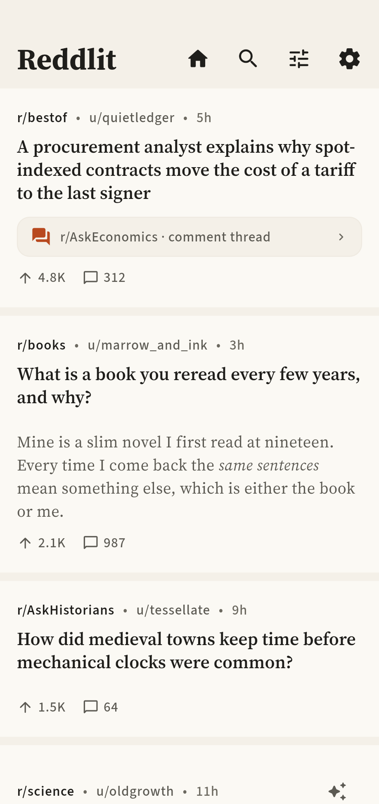
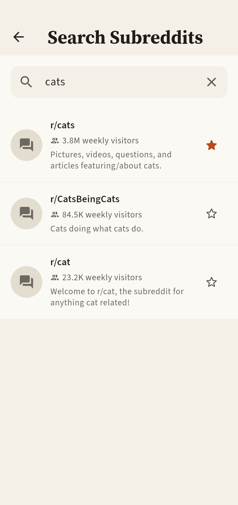
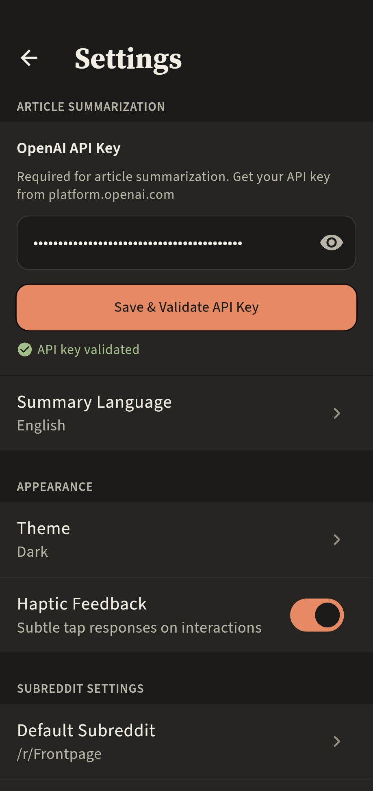

# Reddlit

A minimalist Reddit reader for people who just want to lurk. Started as a weekend build, then kept limping along as Reddit found new ways to make reading a website hard. Share, fork, use.

No feed algorithm, no "for you," no app that's 90% chrome, ads, and "open in app" nags wrapped around 10% content. Just posts, comments, and the occasional cat.

## Why it scrapes old.reddit (and asks for a login it never actually uses)

Reddit's public `.json` API used to be one URL away. Then the IPO happened, the ad machine got hungry, and anonymous requests started getting bounced with a cheerful "you've been blocked by network security." Translation: you're on a VPN, or you're not reliably viewing ads, so you are, apparently, a threat. To network security. Of a website. Sure.

So the data layer now scrapes `old.reddit.com` HTML like it's 2012, because old.reddit is the last corner of the site that still renders content instead of a login wall stacked on three ad units and a cookie banner.

When your IP is flagged (VPNs, shared carriers, anything Reddit doesn't like the smell of), even old.reddit refuses anonymous reads. The only fix is to look like a logged-in browser, so the app can borrow your session: sign in once through Reddit's own login page (in-app WebView, or paste a `reddit_session` cookie), and it replays that session on every request. That is the entire purpose of the login.

To be crystal clear about what that login is **not**:

- It uses zero account features. No voting, no posting, no commenting, no messages, no subscribing on Reddit's side. Still pure lurking.
- Every "favorite" and "subscribe" lives on **your device** in local storage. Reddit never hears about it.
- The session exists purely to get past the ad-serving "security" layer. If your network isn't blocked, you don't need to sign in at all.

Your password never touches this app's code: login happens on Reddit's real page, and only the resulting session cookie is kept, in the OS secure store. You can view or copy that token from Settings, and log out to wipe it.

## Features

- **Pure lurking** - frontpage, any subreddit, user profiles, and full comment threads. No account actions, ever.
- **Full media** - images, galleries, Reddit-hosted video, YouTube embeds, and external-link previews.
- **Nested comments** - collapsible threads, tap to expand, real reply counts.
- **On-device personalization** - favorite subreddits and users, a "Following" feed, a default view, dark mode. All local, all yours.
- **AI article summaries (optional)** - one-tap summary of an external article link via OpenAI. Bring your own key.

## Screenshots

<p align="center">
  
  
  
</p>

## Download

Grab the latest APK from [Releases](../../releases).

## Build from Source

Requires Flutter 3.50.1+ (pinned in `.fvmrc`) and JDK 17+.

```bash
git clone https://github.com/nesdeq/reddlit.git
cd reddlit
flutter pub get
flutter build apk --release
```

The APK lands at `build/app/outputs/flutter-apk/app-release.apk`.

Targets Android. The Dart is platform-agnostic, so `flutter create .` will regenerate iOS / desktop / web scaffolds if you want them (desktop is handy for quick testing, though inline video needs a mobile video backend and the WebView login is mobile-only).

## Configuration (optional, only for AI summaries)

1. Get an API key from [OpenAI](https://platform.openai.com).
2. Open Settings and paste it.

Article text is fetched through Jina Reader and summarized by OpenAI. Your key is stored locally and only leaves the device to call those two services.

## Tech Stack

- Flutter / Dart
- Provider (state management)
- old.reddit.com HTML scraping (no official API, no OAuth, no account actions, session cookie only when the network is blocked)
- Optional: Jina Reader + OpenAI for summaries

## License

MIT. It's a Reddit reader, not a moonshot.

The bundled fonts (Source Sans 3, Source Serif 4) are under the SIL Open Font License 1.1: see `assets/fonts/`.
